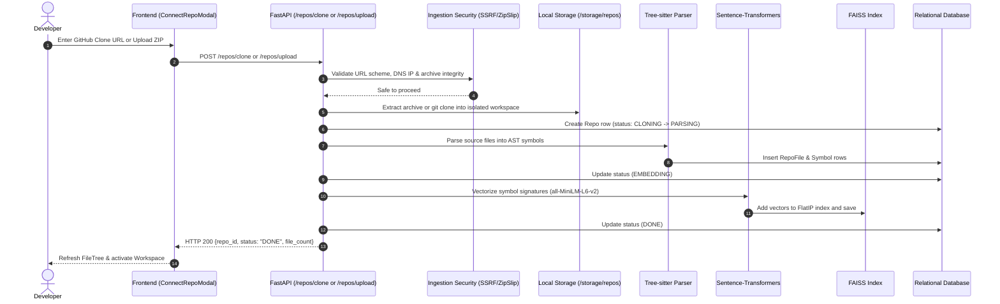
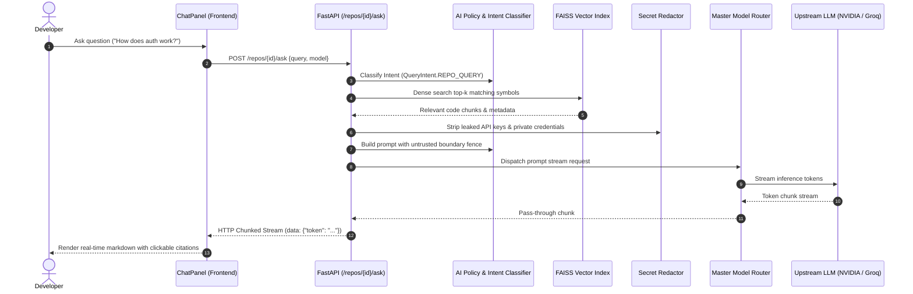
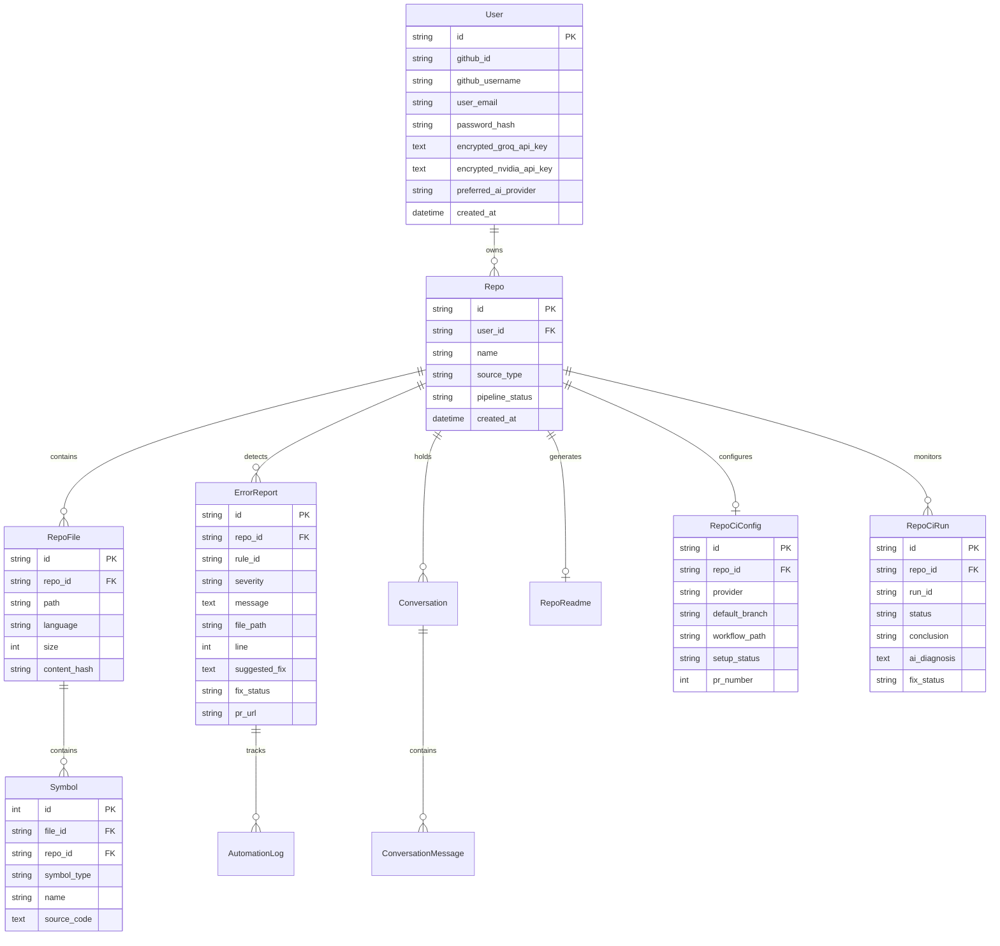

# CodeBrain — System Architecture Specification (ARCHITECTURE.md)

**System Name:** CodeBrain  
**Architecture Version:** 2.0.0  
**Backend:** FastAPI (Python 3.11)  
**Frontend:** React 19 + TypeScript + Vite  
**Persistence:** SQLite (`app.db`) / PostgreSQL + FAISS Vector Store  
**Last Updated:** October 2026  

---

## 1. System Overview

CodeBrain is an AI-powered software intelligence platform designed for repository ingestion, deep AST code analysis, RAG-grounded natural language Q&A, static issue detection, sandboxed patch validation, automated 16-section technical documentation, and autonomous CI/CD failure remediation.

```mermaid
flowchart TD
    subgraph ClientLayer["Frontend Presentation Layer (React 19 + Vite)"]
        UI[Web SPA Browser Client]
        Monaco[Monaco Code Editor]
        ChatUI[Streaming Copilot Chat]
        DocUI[16-Section Doc Viewer]
        TermUI[Interactive WebSockets Terminal]
    end

    subgraph GatewayLayer["API & Security Gateway (FastAPI)"]
        MainApp[FastAPI Coordinator (main.py)]
        SecHeaders[Security Headers Middleware (CSP, HSTS)]
        RateLimiter[Sliding-Window Rate Limiter]
        AuthService[Auth & Session Manager (Fernet + PBKDF2)]
    end

    subgraph RoutingLayer["Application Subsystems (APIRouters)"]
        RepoRouter["/repos (Clone, Upload, AST)"]
        AskRouter["/repos/{id}/ask (RAG Q&A)"]
        DocsRouter["/docs (16-Section Master Gen)"]
        ErrorsRouter["/errors & /codefix (Fix & Sandbox)"]
        CiRouter["/cicd & /gitops (PRs & Action Logs)"]
        TermRouter["/terminals (PTY & WebSockets)"]
    end

    subgraph EngineLayer["Core Analysis & AI Engines"]
        TreeSitter[Tree-sitter AST Parser]
        VectorEngine[Sentence-Transformers all-MiniLM-L6-v2]
        FAISS[(FAISS FlatIP Vector Index)]
        AIRouter[Centralized Model Router]
        SandboxRunner[Sandbox Execution Runtime]
    end

    subgraph ProviderLayer["External AI Providers & Services"]
        NVIDIA[NVIDIA NIM (GLM 5.3, Nemotron)]
        Groq[Groq (Llama 3.3 70B, Whisper)]
        Anthropic[Anthropic (Claude 3.5 Sonnet)]
        APInex[APInex (GPT-6 Luna)]
        GitHub[GitHub REST & GraphQL API]
    end

    subgraph StorageLayer["Data & Index Persistence"]
        DB[(Relational DB: SQLite / PostgreSQL)]
        FileStore[(Local Storage / storage/repos)]
    end

    UI --> SecHeaders --> MainApp
    MainApp --> RateLimiter --> AuthService
    AuthService --> RoutingLayer

    RepoRouter --> TreeSitter --> VectorEngine --> FAISS
    RepoRouter --> FileStore
    AskRouter --> FAISS
    AskRouter --> AIRouter
    ErrorsRouter --> SandboxRunner
    CiRouter --> GitHub
    DocsRouter --> AIRouter

    AIRouter --> NVIDIA
    AIRouter --> Groq
    AIRouter --> Anthropic
    AIRouter --> APInex

    RoutingLayer --> DB
```

---

## 2. Technology Stack

| Domain | Technology | Version | Purpose / Responsibility |
| :--- | :--- | :--- | :--- |
| **Frontend Framework** | React | `^19.2.8` | Declarative UI framework. |
| **Frontend Language** | TypeScript | `~6.0.2` | Type-safe application development. |
| **Build Tool** | Vite | `^8.2.0` | Ultra-fast bundling, HMR, and build pipeline. |
| **Styling** | TailwindCSS | `^4.3.3` | Utility-first CSS framework with modern tokens. |
| **Code Editor** | Monaco Editor | `^4.7.0` | In-browser VS Code editing experience. |
| **Diagram Engine** | Mermaid.js | `^11.16.1` | Dynamic SVG rendering for architectural blueprints. |
| **PDF Processing** | PDF.js | `^4.10.38` | Client-side PDF previewing. |
| **Backend Framework**| FastAPI | Latest | Asynchronous Python REST API coordinator. |
| **ASGI Server** | Uvicorn | Latest | High-performance async ASGI server. |
| **AST Engine** | Tree-sitter | Latest | Multi-language syntactic analysis and symbol extraction. |
| **Embeddings** | Sentence-Transformers | Latest | Local dense vector calculation (`all-MiniLM-L6-v2`, 384-dim). |
| **Vector Database** | FAISS (`faiss-cpu`) | Latest | High-speed FlatIP dense similarity index. |
| **ORM** | SQLAlchemy | Latest | Relational database mapping and migrations. |
| **Primary Database** | SQLite / PostgreSQL | 3.x / 15+ | Relational metadata, session, issue, and run tracking. |
| **Cache & Limiter** | Redis | `7-alpine` | Distributed cache and cross-worker pub/sub. |
| **Document Export** | ReportLab | Latest | Server-side enterprise PDF report generation. |
| **Security & Crypto** | Cryptography (Fernet) | Latest | Token encryption at rest and secure session signing. |

---

## 3. Repository Structure

```
ai/
├── .env.example                       # Documented environment variables with dummy defaults
├── docker-compose.yml                 # Multi-container orchestration (Redis, Backend, Frontend)
├── PRD.md                             # Product Requirements Document
├── AGENTS.md                          # AI Coding Agent Instructions
├── DESIGN_SYSTEM.md                   # Design System & UI Token Specification
├── ARCHITECTURE.md                    # System Architecture Specification (This Document)
├── backend/
│   ├── ai/                            # Multi-provider model router, policies, quota manager
│   │   ├── providers/                 # Provider adapters (nvidia, groq, anthropic, apinex)
│   │   ├── config.py                  # AI environment variable loader
│   │   ├── policy.py                  # Prompt templates, intent classification, prompt fences
│   │   ├── quota_manager.py           # Persistent APInex token quota accounting
│   │   ├── registry.py                # Master AI Provider & Model Registry
│   │   └── router.py                  # Dynamic routing, fallback chains, streaming handler
│   ├── automation/                    # CI/CD pipelines & diagnosis
│   │   ├── auto_fix_pipeline.py       # Autonomous issue-fix-PR state machine
│   │   ├── ci_diagnosis.py            # GitHub Actions error log parser & categorizer
│   │   └── deployment_detector.py     # Detects Vercel, Render, Docker, GitHub Pages
│   ├── codefix/                       # Fix generation and sandboxed validation
│   │   ├── explainer.py               # AI issue root cause explainer
│   │   ├── fixer.py                   # Unified diff generator
│   │   ├── sandbox.py                 # Isolated subprocess/docker execution test runner
│   │   └── patch_safety.py            # Patch AST validation and path boundary checks
│   ├── docgen/                        # 16-Section Master Documentation Generator
│   │   ├── master_doc_gen.py          # Section orchestrator and markdown assembler
│   │   ├── diagram_engine.py          # Mermaid diagram synthesizer
│   │   ├── schema.py                  # 16-Section Pydantic schema validation
│   │   ├── validator.py               # Cross-section zero-hallucination verifier
│   │   ├── secret_redactor.py         # Automated API key and token redactor
│   │   ├── pdf_exporter.py            # ReportLab PDF exporter
│   │   ├── html_exporter.py           # Styled standalone HTML exporter
│   │   └── json_exporter.py           # Structured JSON exporter
│   ├── errordetection/                # Static analysis error scanner
│   │   ├── scanner.py                 # Tree-sitter & AST pattern scanner
│   │   └── suggestion.py              # Rule definitions and issue categorization
│   ├── execution/                     # Execution provider abstractions
│   │   ├── provider.py                # BaseExecutionProvider (Docker, Remote, Subprocess, Null)
│   │   └── docker_provider.py         # Isolated Docker container runner
│   ├── gitops/                        # Git automation & GitHub API
│   │   ├── git_ops.py                 # Local GitPython repository operations
│   │   ├── pr_client.py               # GitHub REST & GraphQL pull request client
│   │   └── github_actions.py          # Remote workflow dispatch and run polling
│   ├── routers/                       # HTTP API endpoints
│   │   ├── ask.py                     # Streaming RAG Q&A
│   │   ├── auth.py                    # Registration, login, dev-login, GitHub OAuth
│   │   ├── cicd.py                    # CI/CD configurations and diagnosis
│   │   ├── codefix.py                 # Fix generation and patch validation
│   │   ├── conversations.py           # 7-day conversation history
│   │   ├── docs.py                    # Master documentation generation & download
│   │   ├── errors.py                  # Static error scanning
│   │   ├── gitops.py                  # Branching, commits, PR creation
│   │   ├── repos.py                   # Ingestion, clone, upload, file trees, file content
│   │   └── terminals.py               # Pseudoterminal WebSocket server
│   ├── storage/                       # Local file storage (repos, extracted trees, indices)
│   ├── terminals/                     # Multi-terminal manager and PTY sessions
│   ├── tests/                         # Pytest test suite (244 tests passing)
│   ├── auth.py                        # Cryptographic token utilities and session guards
│   ├── database.py                    # SQLAlchemy database engine and session factory
│   ├── main.py                        # FastAPI entrypoint, middleware, CORS, error handling
│   ├── models.py                      # Database models (User, Repo, Symbol, ErrorReport, etc.)
│   └── rate_limiter.py                # Sliding-window rate limiter & failed login tracker
└── frontend/
    ├── src/
    │   ├── components/                # Reusable UI components (Editor, Chat, BottomPanel, etc.)
    │   ├── pages/                     # Routed views (HomePage, DashboardPage, Docs, CI/CD)
    │   ├── api.ts                     # Centralized typed API client
    │   ├── types.ts                   # TypeScript interfaces
    │   ├── index.css                  # Design system tokens and styles
    │   └── App.tsx                    # Top-level router and auth protection
    ├── test_rendering.mjs             # 20 frontend rendering and streaming unit tests
    └── package.json                   # Dependencies and scripts
```

---

## 4. Application Modules and Subsystems

### 4.1 Ingestion & Parsing Subsystem
- **Component:** `backend/routers/repos.py` + `backend/errordetection/scanner.py`.
- **Workflow:** Ingests repository via ZIP upload or GitHub clone. Sanitizes paths, extracts Tree-sitter AST nodes (function definitions, class declarations, parameters, return types), and persists `RepoFile` and `Symbol` database rows.

### 4.2 Vector Retrieval Subsystem
- **Component:** `backend/vectorstore/index.py` + `backend/rag/answer.py`.
- **Workflow:** Embeds symbol source representations into 384-dimensional dense vectors using `sentence-transformers/all-MiniLM-L6-v2`. Writes serialized FAISS FlatIP indices to `backend/storage/indices/{repo_id}.faiss`.

### 4.3 Centralized Model Router & AI Gateway
- **Component:** `backend/ai/registry.py` + `backend/ai/router.py`.
- **Workflow:** Normalizes provider and model IDs. Manages priority fallback chains (e.g., APInex -> NVIDIA -> Groq). Enforces secret redaction on prompt contexts and streams tokens via chunked HTTP transfer.

### 4.4 Automated Remediation & Sandbox Engine
- **Component:** `backend/codefix/fixer.py` + `backend/execution/provider.py`.
- **Workflow:** Dispatches detected error contexts to the AI fixer to generate unified diff patches. Executes patches against a temporary repository sandbox running isolated test suites.

### 4.5 Master 16-Section Documentation Engine
- **Component:** `backend/docgen/master_doc_gen.py`.
- **Workflow:** Synthesizes code graphs, database schemas, API specs, and test summaries into 16 structured Markdown sections with Mermaid diagrams, exported to PDF, HTML, JSON, or Markdown.

---

## 5. Request and Data Flow

### 5.1 Repository Ingestion Sequence



### 5.2 RAG Q&A Streaming Sequence



---

## 6. Database and Storage Architecture

### 6.1 Relational Schema (`backend/models.py`)



### 6.2 Filesystem Storage Layout
- `backend/storage/repos/{repo_id}/`: Physical workspace of cloned or extracted codebases.
- `backend/storage/indices/{repo_id}.faiss`: Serialized FAISS vector index binary.
- `backend/storage/indices/{repo_id}_meta.json`: Vector mapping metadata (symbol ID, file path).

---

## 7. APIs and External Interfaces

| Endpoint | Method | Responsibility | Security & Guards |
| :--- | :--- | :--- | :--- |
| `/auth/register` | `POST` | Create new email/password account. | IP rate limited (5/min). |
| `/auth/login` | `POST` | Authenticate and issue session cookie. | Sliding backoff on failures (HTTP 429). |
| `/auth/dev-login` | `POST` | Instant developer login. | **Gated:** Disabled in `ENVIRONMENT=production`. |
| `/auth/me` | `GET` | Get current authenticated user profile. | Session cookie verification. |
| `/repos` | `GET` | List authenticated user's repositories. | Tenant isolation (User ID match). |
| `/repos/clone` | `POST` | Clone repository from GitHub HTTPS URL. | SSRF & private IP rejection. |
| `/repos/upload` | `POST` | Ingest uploaded `.zip` archive. | Zip Slip, size cap, and symlink check. |
| `/repos/{id}/file-content` | `GET` | Read contents of a workspace file. | Canonical path traversal boundary check. |
| `/repos/{id}/ask` | `POST` | Stream RAG Q&A answer tokens. | Rate-limited, prompt fence, secret redactor. |
| `/errors/{id}/scan` | `POST` | Trigger static AST analysis scan. | Background task execution. |
| `/codefix/{id}/fix` | `POST` | Generate unified diff for an issue. | Provider token quota checks. |
| `/codefix/{id}/validate` | `POST` | Validate patch in execution sandbox. | Isolated execution provider. |
| `/docs/{id}/generate` | `POST` | Run 16-section master docgen. | Background task with progress tracking. |
| `/docs/{id}/export/{format}` | `GET` | Export docs (markdown, pdf, html, json). | Content-Disposition file download. |
| `/cicd/{id}/runs` | `GET` | Fetch remote GitHub Actions runs. | Encrypted GitHub token retrieval. |
| `/cicd/{id}/diagnose` | `POST` | Parse and diagnose CI failure logs. | Categorization and AI repair pipeline. |
| `/terminals/ws/{id}` | `WS` | Interactive pseudoterminal streaming. | User session auth, isolated shell process. |

---

## 8. Security Architecture

1. **Authentication & Session Tokens:**
   - Client session identifier stored in signed `session_token` cookie.
   - Enforces `HttpOnly`, `SameSite=Lax`, and `Secure` (under HTTPS/production).
   - Startup fails closed if `SESSION_SECRET` is unset or default in production.
2. **Credential Encryption at Rest:**
   - User third-party tokens (GitHub, Groq, NVIDIA, Anthropic) are encrypted using Fernet symmetric cryptography (`ENCRYPTION_KEY`).
3. **SSRF & Ingestion Protection:**
   - Scheme verification: strictly `https://`.
   - Host resolution check: DNS IP address verified against loopback, private ranges, link-local, and cloud metadata (`169.254.169.254`).
4. **Archive Security:**
   - ZIP extraction prevents Zip Slip (`../`), enforces maximum nesting depth (20), maximum entries (10,000), single file size (50MB), total uncompressed size (200MB), and drops Unix symlinks (`0o120000`).
5. **Browser Defense-in-Depth:**
   - Injected security headers on every response:
     - `Content-Security-Policy: default-src 'self'; ...`
     - `X-Content-Type-Options: nosniff`
     - `X-Frame-Options: DENY`
     - `Referrer-Policy: strict-origin-when-cross-origin`
     - `Permissions-Policy: geolocation=(), camera=(), microphone=()`
     - `Strict-Transport-Security: max-age=31536000; includeSubDomains` (in production).
6. **Centralized Error Redaction:**
   - Unhandled exceptions logged internally with a correlation ID; public clients receive generic error payloads without internal stack traces or server file paths.

---

## 9. Background Jobs and Sandboxing

CodeBrain isolates untrusted repository code execution through the `BaseExecutionProvider` abstraction (`backend/execution/provider.py`):

```
┌────────────────────────────────────────────────────────┐
│             BaseExecutionProvider Abstraction          │
├────────────────────────────────────────────────────────┤
│ + run_command(cmd, cwd, env_overrides, timeout_sec)    │
│ + validate_patch(patch_diff, test_cmd, cwd)            │
└──────────────────────────┬─────────────────────────────┘
                           │
         ┌─────────────────┼─────────────────┐
         ▼                 ▼                 ▼
┌─────────────────┐ ┌─────────────┐ ┌─────────────────┐
│ DockerExecution │ │ Subprocess  │ │ NullExecution   │
│ Provider        │ │ Provider    │ │ Provider        │
│ (Container cgroup│ │ (Scrubbed   │ │ (Closed-gate    │
│  --network none)│ │  Local Dev) │ │  Fail-Safe)     │
└─────────────────┘ └─────────────┘ └─────────────────┘
```

- **DockerExecutionProvider:** Runs test commands inside disposable Docker containers (`--network none`, `--memory 512m`, `--cpus 1.0`).
- **SubprocessExecutionProvider:** Permitted only in `ENVIRONMENT=development` for local testing with scrubbed environment variables.
- **NullExecutionProvider:** Production default when no container runtime is available, guaranteeing untrusted code is never executed directly on the host.

---

## 10. Developer Setup and Onboarding

### Prerequisites
- Node.js 20+ and npm 10+
- Python 3.11+
- Git 2.40+
- (Optional) Docker & Docker Compose for containerized execution.

### Local Setup Steps
```bash
# 1. Clone repository
git clone https://github.com/AnniiGCP/MAJOR-PROJECT.git
cd MAJOR-PROJECT

# 2. Setup backend
cd backend
python -m venv .venv
source .venv/bin/activate  # Windows: .venv\Scripts\activate
pip install -r requirements.txt
cp .env.example .env

# 3. Setup frontend
cd ../frontend
npm install

# 4. Start Development Servers
# Terminal 1 (Backend):
cd backend
python -m uvicorn main:app --reload --port 8000

# Terminal 2 (Frontend):
cd frontend
npm run dev
```

### Verification Commands
```bash
# Run backend pytest test suite (244 tests)
cd backend
python -m pytest

# Run dedicated security regression test suite
python -m pytest tests/test_production_security_suite.py

# Run frontend rendering unit tests
cd frontend
npm test -- --run

# Run frontend production build
npm run build
```
