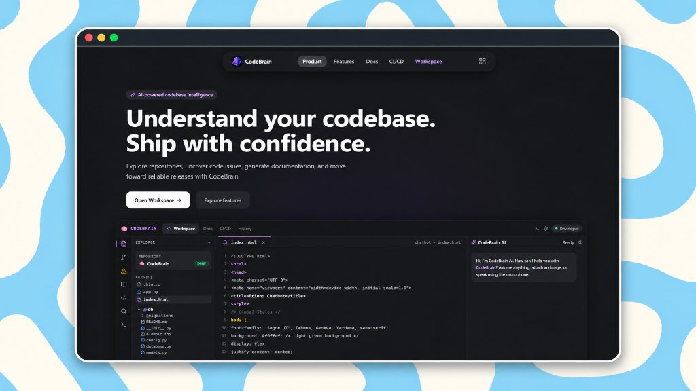
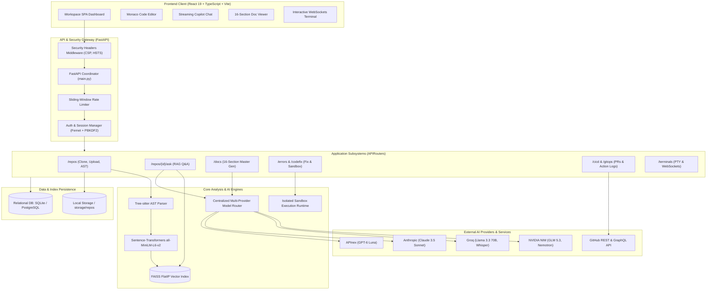
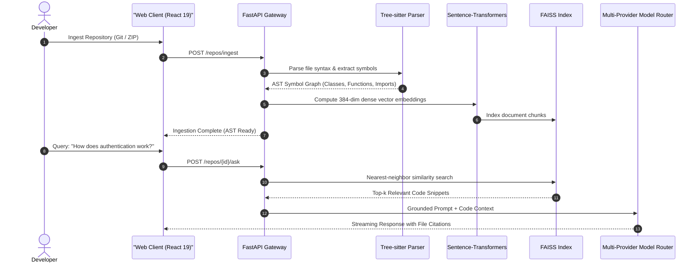

<div align="center">

# CodeBrain AI

### AI-Powered Codebase Understanding, Static Analysis & Documentation Engine with CI/CD Diagnostic Integration

[](https://codebrain-dev.vercel.app/)
[](https://react.dev/)
[](https://fastapi.tiangolo.com/)
[](https://tree-sitter.github.io/)
[](https://github.com/facebookresearch/faiss)
[](backend/tests/)
[](https://www.docker.com/)
[](LICENSE)

**A high-performance software intelligence platform enabling instant repository ingestion, deep AST symbol analysis, RAG-grounded natural language Q&A, automated 16-section enterprise documentation generation, sandboxed patch validation, and autonomous CI/CD failure remediation.**

[Explore Live Demo](https://codebrain-dev.vercel.app/) • [System Architecture](#system-architecture) • [Features](#key-capabilities) • [Setup & Run](#developer-setup--onboarding) • [Testing](#verification--test-suite)

</div>

---

<div align="center">
  
</div>

---

## 1. System Overview

Navigating large, complex software repositories requires developers to manually parse call hierarchies, correlate dispersed documentation, diagnose obscure CI/CD build failures, and trace architectural boundaries.

**CodeBrain** coordinates syntactic static analysis, dense local vector search, and multi-provider LLM orchestration to transform any raw repository into an interactive, self-documenting workspace.



---

## 2. Key Capabilities

### 🔍 Concrete AST Parsing & Static Code Analysis
- Ingests repositories via Git URL cloning or multi-file ZIP archive uploads.
- Language-aware symbol extraction using **Tree-sitter** across Python, TypeScript, JavaScript, Go, and Java.
- Maps imports, exports, class hierarchies, and call graphs without invoking untrusted code.

### 🧠 Semantic Vector RAG Q&A
- Local chunking and dense vector embedding using `sentence-transformers/all-MiniLM-L6-v2` (384 dimensions).
- In-memory similarity retrieval using **FAISS FlatIP**, returning cited code snippets and exact file boundaries.
- Multi-provider model routing across **NVIDIA NIM**, **Groq**, **Anthropic**, and **APInex** with automatic fallback.

### 📚 Automated 16-Section Master Technical Documentation
- Generates exhaustive, structured documentation including:
  1. System Architecture
  2. Data Flow & Sequence Workflows
  3. API Specification Tables
  4. Database Entity Relationships
  5. Security & Threat Modeling
  6. Configuration & Environment Reference
  7. Performance & Optimization Profiles
  8. Deployment & CI/CD Pipelines
- Multi-format export: Markdown, styled HTML, and enterprise PDF via **ReportLab**.

### 🛡️ Sandboxed Patch Validation & Issue Remediation
- Automated AST issue detection and AI patch generation.
- Validates patches inside containerized execution sandboxes (`DockerExecutionProvider` with `--network none`, cgroups CPU and memory caps) before suggesting pull requests.

### 🔄 CI/CD Diagnostic Engine
- Connects to GitHub Actions to ingest failed workflow run logs.
- Categorizes failure root causes (syntax, dependency mismatch, failing assertions, timeout) and generates remediation diffs.

### 💻 Interactive Pseudoterminal (PTY)
- WebSockets streaming terminal (`xterm.js` / custom PTY bridge) enabling real-time terminal execution against workspace environments.

---

## 3. Technology Stack

| Domain | Technology | Version | Purpose |
| :--- | :--- | :--- | :--- |
| **Frontend Framework** | React | `^19.2.8` | Modern declarative UI layer |
| **Language (Frontend)**| TypeScript | `~6.0.2` | Type-safe development |
| **Bundler & Tooling** | Vite | `^8.2.0` | High-velocity build pipeline and HMR |
| **Styling** | Tailwind CSS | `^4.3.3` | Utility-first visual design system |
| **Code Editor** | Monaco Editor | `^4.7.0` | In-browser VS Code editing experience |
| **Diagram Engine** | Mermaid.js | `^11.16.1` | Dynamic SVG architecture rendering |
| **Backend Framework**| FastAPI | Latest | Asynchronous REST coordinator |
| **AST Engine** | Tree-sitter | Latest | Syntax analysis and symbol extraction |
| **Vector Embeddings** | Sentence-Transformers | Latest | Local dense 384-dim semantic embeddings |
| **Vector Index** | FAISS (`faiss-cpu`) | Latest | High-speed dense similarity search |
| **ORM & Database** | SQLAlchemy / SQLite / Postgres | Latest | Relational persistence for sessions and issues |
| **Security & Crypto** | Cryptography (Fernet) | Latest | User token encryption at rest |
| **Test Suite** | Pytest | Latest | 248 unit, integration, and security tests |

---

## 4. Ingestion & Analysis Workflow



---

## 5. Security & Defense-in-Depth

1. **Token Encryption at Rest:** Third-party credentials (GitHub, NVIDIA, Groq, Anthropic) are symmetrically encrypted using **Fernet** (`ENCRYPTION_KEY`).
2. **SSRF Protection:** Strict HTTPS validation and IP host resolution verifying requests do not target loopback (`127.0.0.1`), private RFC1918 subnets, link-local addresses, or cloud metadata endpoints (`169.254.169.254`).
3. **Archive Security:** ZIP extraction enforces Zip Slip prevention (`../`), maximum nesting depth limits, single-file size caps (50MB), total size caps (200MB), and drops Unix symlinks.
4. **Sandboxed Execution:** Untrusted code execution is constrained through `BaseExecutionProvider` with Docker cgroup memory limits (`512MB`), CPU quotas (`1.0`), and zero network access (`--network none`).
5. **Security Headers:** Injected on every response: Content Security Policy (CSP), HSTS, `X-Content-Type-Options: nosniff`, and `X-Frame-Options: DENY`.

---

## 6. Developer Setup & Onboarding

### Prerequisites
- Node.js `20+` and npm `10+`
- Python `3.11+`
- Git `2.40+`
- (Optional) Docker for containerized patch validation

### 1. Clone Repository
```bash
git clone https://github.com/AnniiGCP/CodeBrain.git
cd CodeBrain
```

### 2. Configure Backend
```bash
cd backend
python -m venv .venv

# On Linux / macOS:
source .venv/bin/activate
# On Windows:
.venv\Scripts\activate

pip install -r requirements.txt
cp .env.example .env
```

### 3. Configure Frontend
```bash
cd ../frontend
npm install
```

### 4. Start Development Servers

**Terminal 1 — Backend (Port 8000):**
```bash
cd backend
python -m uvicorn main:app --reload --port 8000
```
*Interactive Swagger documentation available at: `http://localhost:8000/docs`*

**Terminal 2 — Frontend (Port 5173):**
```bash
cd frontend
npm run dev
```

---

## 7. Verification & Test Suite

The codebase includes an extensive automated testing harness with **248 passing tests**:

```bash
# Run complete backend pytest suite
cd backend
python -m pytest

# Run dedicated security regression test suite
python -m pytest tests/test_production_security_suite.py

# Run frontend test suite
cd ../frontend
npm test -- --run

# Validate production frontend build
npm run build
```
