# AI-POWERED CODE ANALYSIS AND AUTOMATED DOCUMENTATION SYSTEM WITH CI/CD INTEGRATION

**System Name:** CodeBrain  
**Repository:** `AnniiGCP/MAJOR-PROJECT`  
**Commit SHA:** `ffa81bf9b438769eb10ac7c33a2410c791daec09`  
**Branch:** `main`  
**Generated Date:** 2026-10-08T13:08:00+05:30  
**Documentation Version:** v2.0  
**Analysis Engine Version:** v1.4  
**Classification:** Enterprise System Architecture & Technical Specifications  

---

## TABLE OF CONTENTS

1. [Project Overview](#1-project-overview)
2. [Technology Stack](#2-technology-stack)
3. [Repository Structure](#3-repository-structure)
4. [System Architecture](#4-system-architecture)
5. [Modules and Components](#5-modules-and-components)
6. [Classes and Functions](#6-classes-and-functions)
7. [APIs and Interfaces](#7-apis-and-interfaces)
8. [Database and Data Model](#8-database-and-data-model)
9. [Database Relationships](#9-database-relationships)
10. [Dependencies](#10-dependencies)
11. [Configuration and Environment](#11-configuration-and-environment)
12. [Testing](#12-testing)
13. [Security](#13-security)
14. [CI/CD Pipeline](#14-cicd-pipeline)
15. [Deployment Architecture](#15-deployment-architecture)
16. [Setup and Developer Guide](#16-setup-and-developer-guide)

---

## 16-SECTION INDEX

| Index | Section Title | Primary Focus |
|---|---|---|
| **01** | Project Overview | Problem statement, core motivation, system capabilities, high-level workflow |
| **02** | Technology Stack | Full stack breakdown across frontend, backend, databases, and AI providers |
| **03** | Repository Structure | Hierarchical filesystem breakdown and modular responsibilities |
| **04** | System Architecture | End-to-end component data flow, RAG pipeline, and async processing |
| **05** | Modules and Components | Subsystem responsibilities, interfaces, inputs, and outputs |
| **06** | Classes and Functions | Core data models, service classes, AST extractors, and routers |
| **07** | APIs and Interfaces | RESTful API specifications, query parameters, payloads, and response schemas |
| **08** | Database and Data Model | Relational schema tables, column definitions, data types, constraints |
| **09** | Database Relationships | Foreign key constraints, cascade rules, and entity lifecycle semantics |
| **10** | Dependencies | Manifest dependencies across Python (pip) and Node.js (npm) |
| **11** | Configuration and Environment | Environment variable matrix, security redactions, and operational defaults |
| **12** | Testing | Test harnesses, test coverage, AST evaluation, and sandbox validation |
| **13** | Security | Token encryption at rest (Fernet), GitHub OAuth, CORS, and credential isolation |
| **14** | CI/CD Pipeline | Automated GitHub Actions workflow, linting, test suites, and PR automation |
| **15** | Deployment Architecture | Docker containerization, multi-service topology, reverse proxy, volumes |
| **16** | Setup and Developer Guide | Step-by-step developer onboarding, installation, execution, troubleshooting |

---

## 1. Project Overview

### 1.1 Executive Summary & Problem Statement
Modern software engineering organizations deal with exponentially growing codebases, high developer turnover, and inconsistent technical documentation. Developers spend up to 40% of their working hours comprehending unfamiliar code, tracking down architectural dependencies, debugging cross-file regression errors, and maintaining synchronization between source code and documentation. Traditional documentation efforts rapidly become obsolete ("documentation rot") because they rely on manual intervention detached from continuous integration and deployment (CI/CD) pipelines.

**CodeBrain** solves this problem by providing an automated, agentic code analysis, natural language comprehension, error detection, automated patch remediation, GitOps workflow orchestration, and multi-format documentation generation platform. By fusing Abstract Syntax Tree (AST) parsing with Retrieval-Augmented Generation (RAG), vector vectorstores (FAISS), and multi-provider Large Language Model (LLM) orchestration, CodeBrain autonomously digests raw codebases (via ZIP archives or GitHub repositories), discovers structural entities, pinpoints static analysis errors, validates AI-generated fixes in sandboxed environments, and generates standardized 16-section technical documentation packages.

### 1.2 System Goals and Value Proposition
- **Autonomous Repository Ingestion:** Seamless intake of codebases via direct archive upload or authenticated GitHub OAuth clone.
- **Deep Syntactic & Semantic Extraction:** Extraction of functions, classes, methods, and call graphs using Tree-sitter AST parsing and sentence transformer embeddings.
- **Deterministic 16-Section Documentation:** Zero-hallucination documentation generation grounded strictly in repository evidence, exportable to Markdown, HTML, JSON, and PDF formats.
- **Closed-Loop Auto-Remediation:** Detection of bugs, syntax flaws, and code smells, followed by LLM-powered unified patch generation and sandboxed regression test execution.
- **GitOps PR Automation:** Autonomous branch creation (`ai-fix/*`), patch committing, remote pushing, pull request creation, and auto-merge polling via the GitHub REST and GraphQL APIs.
- **Multi-Modal Interaction:** Real-time conversational RAG querying alongside voice-driven speech-to-text (Whisper Large v3) intent classification.

### 1.3 High-Level Operational Workflow
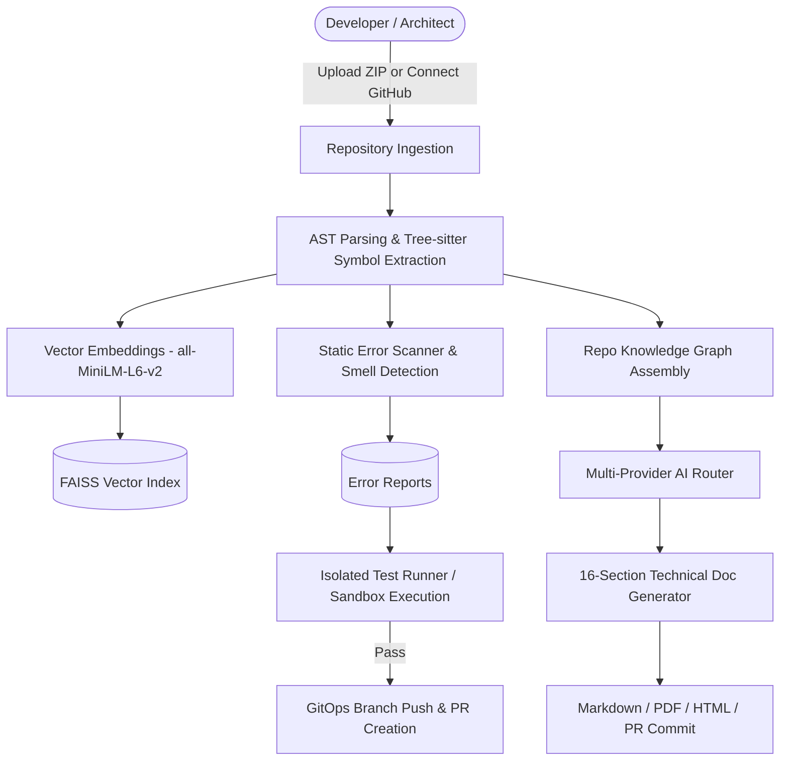

---

## 2. Technology Stack

### 2.1 Complete Technology Matrix
The technology stack for CodeBrain is directly derived from `backend/requirements.txt`, `frontend/package.json`, `docker-compose.yml`, and source code imports.

| Layer | Technology | Version | Purpose | Evidence |
|---|---|---|---|---|
| **Frontend Framework** | React | `^19.2.8` | Component-driven user interface and reactive state tree | `frontend/package.json` |
| **Frontend Language** | TypeScript | `~6.0.2` | Static typing, interface definitions, and compile-time safety | `frontend/package.json` |
| **Build & Dev Tool** | Vite | `^8.2.0` | Ultra-fast HMR dev server and ESBuild/Rollup production bundling | `frontend/package.json` |
| **Styling & CSS** | Tailwind CSS | `^4.3.3` | Utility-first responsive design and modern dark-mode styling | `frontend/package.json` |
| **Code Editor** | Monaco Editor | `^4.7.0` | Web-based syntax-highlighted code editor and diff viewer | `@monaco-editor/react` |
| **Diagram Engine** | Mermaid.js | `^11.16.1` | Client-side visual rendering of architectural and flow diagrams | `frontend/package.json` |
| **PDF Rendering** | PDF.js | `^4.10.38` | In-browser client-side PDF document previewing | `pdfjs-dist` in `package.json` |
| **Backend Framework** | FastAPI | `0.115+` | Asynchronous high-performance REST API with OpenAPI autodocs | `backend/requirements.txt` |
| **ASGI Server** | Uvicorn | `0.30+` | Lightning-fast ASGI production web server | `backend/requirements.txt` |
| **Language & Runtime** | Python | `3.11` | Backend service implementation and AST processing | `.github/workflows/ci.yml` |
| **ORM & Database** | SQLAlchemy / SQLite | `2.0+` | Relational ORM mapping and persistent local relational database | `database.py`, `models.py` |
| **AST Parser** | Tree-sitter & Tree-sitter-languages | `0.21+` | Concrete syntax tree parser for Python, JS, TS, Java, Go, etc. | `backend/requirements.txt` |
| **Embeddings** | Sentence-Transformers | `3.0+` | Local dense vector representations (`all-MiniLM-L6-v2`) | `backend/requirements.txt` |
| **Vector Database** | FAISS (CPU) | `1.8+` | Dense vector similarity indexing and nearest neighbor retrieval | `faiss-cpu` in `requirements.txt` |
| **Primary AI Provider** | NVIDIA NIM | API | LLM inference: Llama 3.2 11B Vision, GLM 5.3, Nemotron 3 Ultra | `backend/ai/providers/` |
| **Fallback AI Provider** | Groq Cloud | API | Ultra-low latency Llama 3.3 70B inference & Whisper STT | `backend/ai/providers/` |
| **Encryption** | Cryptography (Fernet) | `42.0+` | AES-128-CBC encryption of GitHub OAuth tokens & API keys | `backend/auth.py` |
| **PDF Generation** | ReportLab | `4.2+` | Server-side programmatic PDF generation with styling rules | `backend/docgen/pdf_exporter.py` |
| **Git Operations** | GitPython | `3.1+` | Programmatic local git manipulation, checkout, commit, diff | `backend/gitops/git_ops.py` |
| **Containerization** | Docker / Compose | `3.8 Spec` | Containerized deployment for frontend, backend, and Redis | `docker-compose.yml` |

### 2.2 Technology Stack Architecture Diagram
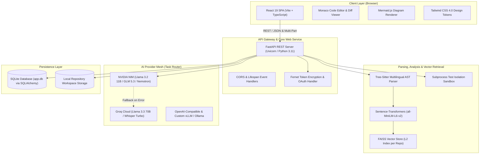

---

## 3. Repository Structure

### 3.1 Directory Tree
The repository layout is organized into a modular decoupled architecture:
```
ai/
├── .github/
│   └── workflows/
│       └── ci.yml               # Automated CI workflow (backend pytest + frontend tsc/vite)
├── backend/
│   ├── ai/                      # Centralized AI router, provider registry, and fallbacks
│   │   ├── providers/           # Concrete provider clients (Nvidia, Groq, Anthropic, Custom)
│   │   ├── config.py            # Model configuration matrices and threshold definitions
│   │   ├── registry.py          # Master catalog of models, limits, and capabilities
│   │   └── router.py            # Task router, fallback execution, observability logger
│   ├── analysis/                # Structural code analyzers and project topology
│   ├── automation/              # Closed-loop auto-fix orchestration and CI workflow setup
│   │   ├── auto_fix_pipeline.py # 6-stage auto-fix-commit-PR pipeline with polling worker
│   │   └── ci_setup.py          # Automated CI workflow generation and PR proposer
│   ├── codefix/                 # Patch generation, explanation, and test sandboxing
│   │   ├── explainer.py         # Natural-language symbol and issue summarizer
│   │   ├── fixer.py             # LLM unified diff patch synthesizer
│   │   └── sandbox.py           # Subprocess isolated test execution and validation
│   ├── docgen/                  # Complete 16-section technical documentation suite
│   │   ├── master_doc_gen.py    # 16-section orchestrator and validation gatekeeper
│   │   ├── repo_analyzer.py     # AST knowledge graph builder and symbol scanner
│   │   ├── html_exporter.py     # Interactive single-page HTML documentation bundler
│   │   ├── pdf_exporter.py      # ReportLab PDF generator with custom styling
│   │   ├── json_exporter.py     # Machine-readable AST and documentation exporter
│   │   └── readme_gen.py        # Autonomous root README synthesizer
│   ├── errordetection/          # AST static error scanner and suggestion generator
│   │   ├── scanner.py           # Multi-language syntax and structural issue detector
│   │   └── suggestion.py        # Fix diff and natural language remediation wrapper
│   ├── gitops/                  # Git and GitHub platform integrations
│   │   ├── git_ops.py           # GitPython wrapper for local cloning, branching, committing
│   │   └── pr_client.py         # GitHub REST and GraphQL API client (PRs, checks, auto-merge)
│   ├── rag/                     # Retrieval-Augmented Generation retrieval and question answering
│   ├── routers/                 # FastAPI HTTP endpoint routers
│   │   ├── ask.py               # RAG codebase Q&A endpoints
│   │   ├── auth.py              # GitHub OAuth, profile, and encrypted key management
│   │   ├── codefix.py           # Symbol explanation, fix generation, patch testing
│   │   ├── docs.py              # 16-section docgen, README, and export endpoints
│   │   ├── embeddings.py        # Vector embedding initiation and semantic search
│   │   ├── errors.py            # Error listing, fix triggering, and status polling
│   │   ├── gitops.py            # Git branch creation, PR triggering, log retrieval
│   │   ├── pipeline.py          # Complete repository pipeline runner and status checks
│   │   └── repos.py             # Repo acquisition, file trees, and CI setup
│   ├── storage/                 # Per-repository cloned source code and document storage
│   ├── tests/                   # Backend pytest test suite (Phase 1 through Phase 8)
│   ├── vectorstore/             # FAISS embedding engine and index manager
│   ├── voice/                   # Audio recording transcription and intent classifier
│   ├── auth.py                  # Token crypto, user sessions, and permission guards
│   ├── database.py              # SQLAlchemy engine, session maker, schema migrations
│   ├── main.py                  # Application entry point, CORS, and router registration
│   ├── models.py                # Relational ORM entity definitions
│   └── requirements.txt         # Python runtime dependencies
├── frontend/
│   ├── src/
│   │   ├── components/          # Reusable UI widgets (Navigation, Editor, Diagrams, Panels)
│   │   ├── pages/               # Top-level view controllers (Dashboard, Docs, CI/CD, History)
│   │   ├── api.ts               # Axios/Fetch client integration layer with backend endpoints
│   │   ├── App.tsx              # React router configuration and auth state wrapper
│   │   ├── index.css            # Tailwind CSS directive imports and theme tokens
│   │   ├── main.tsx             # React DOM root entry point
│   │   └── types.ts             # TypeScript interface definitions across the entire domain
│   ├── package.json             # NPM package manifest
│   ├── tsconfig.json            # TypeScript compiler configuration
│   └── vite.config.ts           # Vite development server and bundling configuration
└── docker-compose.yml           # Multi-container service definitions (frontend, backend, redis)
```

### 3.2 Responsibility Map
| Directory / Subsystem | Primary Responsibility | Critical Files |
|---|---|---|
| `backend/ai/` | Multi-model routing, fallback failover, dynamic registry, token observability | `router.py`, `config.py`, `registry.py` |
| `backend/docgen/` | Knowledge graph assembly, 16-section markdown/PDF/HTML generation | `master_doc_gen.py`, `repo_analyzer.py` |
| `backend/automation/` | Auto-fix orchestration, sandbox verification, CI workflow injection | `auto_fix_pipeline.py`, `ci_setup.py` |
| `backend/codefix/` | Unified patch generation, patch validation, test discovery | `fixer.py`, `sandbox.py` |
| `backend/gitops/` | Branching, commits, GitHub PR creation, GraphQL auto-merge | `git_ops.py`, `pr_client.py` |
| `backend/errordetection/` | Syntax checking, security smell detection, static analysis | `scanner.py`, `suggestion.py` |
| `backend/rag/` | Semantic symbol retrieval, context window assembly, LLM answering | `answer.py`, `index.py` |
| `backend/routers/` | HTTP request routing, input validation, authentication guards | `repos.py`, `pipeline.py`, `docs.py` |
| `frontend/src/pages/` | Routing endpoints: Dashboard, Documentation, CI/CD, History | `DocumentationPage.tsx`, `DashboardPage.tsx` |

---

## 4. System Architecture

### 4.1 Global Architectural Overview
CodeBrain adopts a decoupled client-server micro-monolith architecture. The frontend is a modern Single Page Application (SPA) communicating over RESTful JSON endpoints with an asynchronous FastAPI backend service. 

When a repository is imported, CodeBrain transitions the codebase through a multi-stage deterministic pipeline:
1. **Acquisition:** Cloned via authenticated Git or extracted from ZIP archives into `backend/storage/{repo_id}/`.
2. **Parsing:** Parsed via Tree-sitter multilingual grammars into structured symbols (functions, classes, methods).
3. **Embedding & Vector Storage:** Dense 384-dimensional embeddings are generated with `all-MiniLM-L6-v2` and inserted into a local FAISS index.
4. **Static Error Scanning:** The repository AST is scanned for syntactic errors, unresolved imports, and code smells.
5. **Knowledge Graph Assembly:** Modules, symbols, dependencies, and file relationships are aggregated into a `RepoKnowledgeGraph`.
6. **16-Section Documentation Generation:** The knowledge graph and repository evidence are formatted into the canonical 16-section technical documentation suite.
7. **Closed-Loop Auto-Remediation:** Detected errors trigger LLM patch generation, followed by isolated sandbox testing and GitOps pull request creation.

### 4.2 End-to-End Component Interaction Diagram
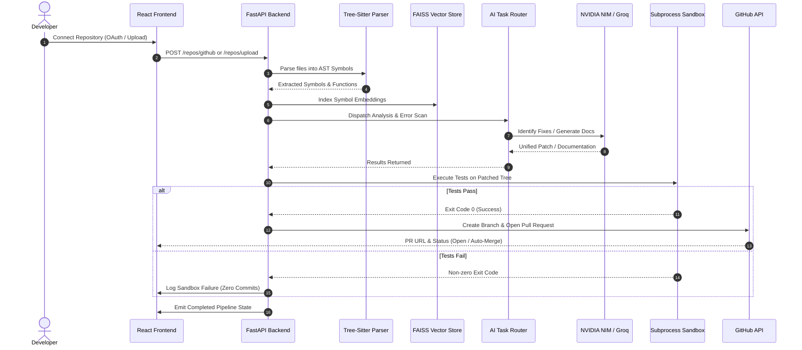

### 4.3 RAG Retrieval and Question Answering Pipeline
The RAG pipeline implemented in `backend/rag/answer.py` retrieves contextually relevant symbols from the codebase to answer developer queries with zero hallucinations:
```mermaid
flowchart LR
    Query[User Question] --> EmbedQuery[Embed Query via MiniLM]
    EmbedQuery --> FAISSSearch[FAISS Cosine Similarity Search]
    FAISSSearch --> TopK[Top-K Matching Symbols]
    TopK --> FilterAuth[Filter by User Access & Repo ID]
    FilterAuth --> ContextBuild[Construct Structured Context Prompt]
    ContextBuild --> ModelRouter[AI Task Router - NVIDIA / Groq]
    ModelRouter --> LLMResponse[Natural Language Answer + Code Citations]
```

---

## 5. Modules and Components

### 5.1 Subsystem Breakdown

#### 5.1.1 Repository Acquisition Subsystem (`backend/routers/repos.py`, `backend/gitops/git_ops.py`)
- **Location:** `backend/routers/repos.py`
- **Purpose:** Handles ZIP upload extraction and authenticated GitHub repository cloning. Validates ZIP structures, strips security risks (path traversal attacks like `../`), and records repository metadata in the database.
- **Inputs:** Multipart ZIP file or GitHub clone URL with OAuth token.
- **Outputs:** Persisted directory structure in `backend/storage/{repo_id}/` and a new `Repo` entity.

#### 5.1.2 AST Parsing and Symbol Extraction Subsystem (`backend/code_parser.py`, `backend/file_walker.py`)
- **Location:** `backend/code_parser.py`
- **Purpose:** Employs Tree-sitter parsers to walk directory trees, filter ignored directories (`.git`, `node_modules`, `venv`, `__pycache__`), and extract language-specific symbols (classes, functions, signatures, docstrings).
- **Inputs:** File paths from repository storage.
- **Outputs:** Persisted `RepoFile` and `Symbol` database rows.

#### 5.1.3 Vector Indexing and Semantic Retrieval Subsystem (`backend/vectorstore/`, `backend/rag/`)
- **Location:** `backend/vectorstore/embedder.py`, `backend/vectorstore/index.py`, `backend/rag/answer.py`
- **Purpose:** Encodes extracted symbol source code into 384-dimensional dense vectors using `sentence-transformers/all-MiniLM-L6-v2`. Maintains a dedicated FAISS index on disk (`index.faiss`) for each repository.
- **Inputs:** Symbol source text strings and query queries.
- **Outputs:** Ranked semantic search results and grounded prompt contexts.

#### 5.1.4 Centralized AI Task Router Subsystem (`backend/ai/`)
- **Location:** `backend/ai/router.py`, `backend/ai/config.py`, `backend/ai/registry.py`
- **Purpose:** Dispatches LLM tasks based on `TaskType` (`chat`, `code`, `debug`, `document`, `vision`, `transcribe`) with automatic fallback failover, token latency tracking, and error handling.
- **Inputs:** Task request, system prompt, user prompt, and temperature.
- **Outputs:** Completed LLM generation text or async streaming tokens.

#### 5.1.5 Error Detection and Closed-Loop Remediation Subsystem (`backend/errordetection/`, `backend/codefix/`, `backend/automation/`)
- **Location:** `backend/errordetection/scanner.py`, `backend/codefix/fixer.py`, `backend/codefix/sandbox.py`, `backend/automation/auto_fix_pipeline.py`
- **Purpose:** Identifies static errors, generates unified diff patches, applies patches to temporary directories, and executes detected unit test suites (`pytest`, `npm test`, `cargo test`, `go test`).
- **Inputs:** Broken source code files and scanner issues.
- **Outputs:** `ValidationResult` (Passed / Failed), `ErrorReport` state transition, and GitHub Pull Requests.

#### 5.1.6 16-Section Documentation Subsystem (`backend/docgen/`)
- **Location:** `backend/docgen/master_doc_gen.py`, `backend/docgen/repo_analyzer.py`, `backend/docgen/pdf_exporter.py`
- **Purpose:** Gathers the repository knowledge graph, validates evidence across all 16 domains, executes structured prompt synthesis, validates Mermaid diagrams, and exports documents to Markdown, PDF, HTML, and ZIP archives.
- **Inputs:** `RepoKnowledgeGraph` compiled from AST, database models, requirements, and workflows.
- **Outputs:** 16 Markdown files, `FULL_PROJECT_DOCUMENTATION.md`, and PDF binaries.

### 5.2 Module Interaction Architecture
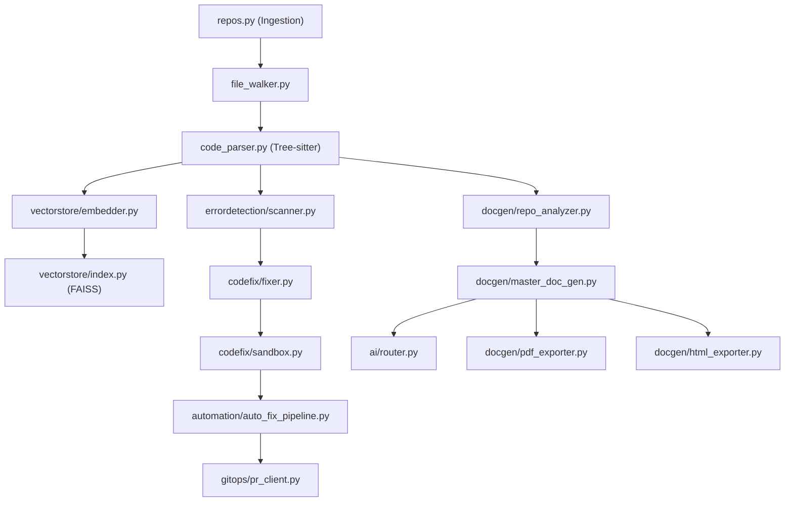

---

## 6. Classes and Functions

### 6.1 Core Class and Function Specifications
The following tables document the primary architectural classes and functions implemented in the backend codebase.

| Class / Function | Source File | Purpose | Primary Inputs | Return / Output |
|---|---|---|---|---|
| `RepoKnowledgeGraph` | `docgen/repo_analyzer.py` | Structured in-memory model of code symbols, dependencies, and architecture | Directory path, database session | Dataclass instance with modules, classes, and calls |
| `analyze_repository` | `docgen/repo_analyzer.py` | Traverses repository to build the `RepoKnowledgeGraph` | `repo_root: Path`, `db: Session` | `RepoKnowledgeGraph` |
| `generate_full_project_documentation` | `docgen/master_doc_gen.py` | Orchestrates generation and schema validation of all 16 documentation sections | `repo_id: str`, `db: Session` | `FullDocSuiteResult` |
| `validate_mermaid_syntax` | `docgen/master_doc_gen.py` | Ensures generated diagrams contain balanced brackets, valid directives, and no illegal characters | `code: str` | `bool` |
| `AIRouter.complete` | `ai/router.py` | Dispatches completion requests through configured primary and fallback providers | `task: TaskType`, `prompt: str`, `system_prompt: str` | `str` (Completed text) |
| `validate_patch` | `codefix/sandbox.py` | Applies a unified diff to a temporary workspace and executes detected test runners | `repo_id: str`, `file_path: str`, `patched_content: str` | `ValidationResult` (passed, exit_code, output) |
| `run_auto_fix_pipeline` | `automation/auto_fix_pipeline.py` | Executes detection -> patch -> sandbox -> commit -> PR -> auto-merge pipeline | `repo_id: str`, `error_id: str`, `db: Session` | `dict` (status, pr_url, branch) |
| `create_pull_request` | `gitops/pr_client.py` | Opens a pull request against target GitHub repository using the GitHub REST API | `token: str`, `repo: str`, `head: str`, `base: str`, `title: str`, `body: str` | `dict` (PR metadata, html_url, id) |
| `enable_auto_merge` | `gitops/pr_client.py` | Issues GraphQL mutation to enable automated merge once check runs succeed | `token: str`, `pull_request_node_id: str` | `bool` |
| `transcribe_audio` | `voice/transcribe.py` | Transcribes audio bytes using Groq Whisper Large v3 Turbo | `audio_bytes: bytes`, `filename: str` | `str` (Transcribed text) |
| `classify_intent` | `voice/intent.py` | Categorizes user voice input into discrete actions (`ask`, `fix`, `docs`, `explain`) | `text: str` | `tuple[str, str, float]` (intent, target, score) |
| `encrypt_secret` / `decrypt_secret` | `auth.py` | Encrypts and decrypts OAuth tokens and provider API keys at rest using Fernet | `plain_text: str` / `cipher_text: str` | `str` |

### 6.2 Class Relationship Diagram
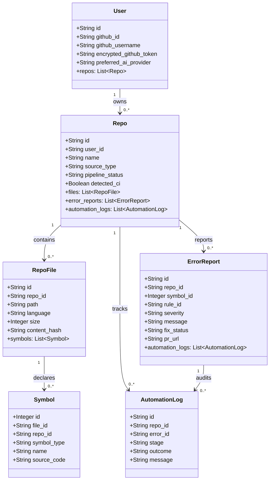

---

## 7. APIs and Interfaces

### 7.1 Verified REST API Endpoint Catalog
Every endpoint listed below is verified against `backend/routers/` and `backend/main.py`.

| Method | Endpoint Path | Subsystem | Authentication | Description |
|---|---|---|---|---|
| `GET` | `/` | System | Public | Root metadata endpoint returning service name, status, and doc URLs |
| `GET` | `/health` | System | Public | Liveness probe returning health status and API version (`0.8.0`) |
| `GET` | `/me` | Auth | Cookie / Session | Returns current authenticated user profile and connected accounts |
| `POST` | `/logout` | Auth | Cookie / Session | Terminates user session and clears authentication cookies |
| `POST` | `/auth/dev-login` | Auth | Public (Dev mode) | Development and testing bypass login granting mock user credentials |
| `GET` | `/auth/github/login` | Auth | Public | Initiates GitHub OAuth flow by generating authorization redirect URL |
| `GET` | `/auth/github/callback`| Auth | Public | GitHub OAuth redirect handler; trades code for token, stores encrypted |
| `GET` | `/auth/github/repos` | Auth | Session / Token | Queries GitHub API for authenticated user's remote repositories |
| `GET` | `/auth/keys` | Auth | Session | Reports configuration status of API keys across NVIDIA, Groq, Anthropic |
| `POST` | `/auth/keys` | Auth | Session | Encrypts and saves custom user API keys and preferred provider options |
| `DELETE`| `/auth/keys/{provider}`| Auth | Session | Purges stored encrypted API key for specified provider |
| `GET` | `/ai/models` | AI Router | Session | Returns master catalog of configured AI models, context windows, and tasks |
| `POST` | `/repos/upload` | Ingestion | Session | Accepts multipart `.zip` archive, unpacks files, initializes repo |
| `POST` | `/repos/github` | Ingestion | Session | Clones remote repository via GitHub OAuth token |
| `GET` | `/repos/` | Repos | Session | Lists all repositories owned by the authenticated user |
| `GET` | `/repos/{id}/files` | Repos | Session | Retrieves hierarchical file and directory tree for repository |
| `GET` | `/repos/{id}/file-content` | Repos | Session | Retrieves raw source text of specific file using query parameter `path` |
| `DELETE`| `/repos/{id}` | Repos | Session | Purges repository files, vector indexes, and database records |
| `POST` | `/repos/{id}/pipeline/run` | Pipeline | Session | Initiates background asynchronous ingestion, parsing, and analysis |
| `GET` | `/repos/{id}/pipeline/status`| Pipeline | Session | Returns current execution stage: `CLONING`, `PARSING`, `EMBEDDING`, `DONE` |
| `GET` | `/repos/{id}/pipeline/results`| Pipeline | Session | Returns execution summary (symbols extracted, files processed, duration) |
| `POST` | `/repos/{id}/embed` | Embeddings | Session | Triggers vector embedding generation across all unindexed symbols |
| `POST` | `/repos/{id}/search` | Embeddings | Session | Executes semantic nearest-neighbor search against FAISS vector index |
| `POST` | `/repos/{id}/ask` | RAG | Session | Natural language conversational Q&A against repository code context |
| `GET` | `/repos/{id}/errors` | Errors | Session | Lists all static analysis errors, warnings, and smells detected |
| `POST` | `/repos/{id}/errors/{err}/generate-fix` | Errors | Session | Generates natural language explanation and unified diff fix |
| `POST` | `/repos/{id}/errors/{err}/apply-fix` | Errors | Session | Triggers full auto-fix pipeline (sandbox test, branch, PR creation) |
| `POST` | `/repos/{id}/docs/readme` | Docs | Session | Autonomous synthesis of repository root `README.md` |
| `POST` | `/repos/{id}/docs/master` | Docs | Session | Generates canonical 16-section technical documentation suite |
| `GET` | `/repos/{id}/docs/sections` | Docs | Session | Retrieves all 16 generated documentation sections |
| `POST` | `/repos/{id}/docs/commit-to-repo` | Docs | Session | Commits generated documentation directly to repo branch and opens PR |
| `GET` | `/repos/{id}/docs/export/download` | Docs | Session | Downloads documentation as ZIP, PDF, or HTML format |
| `POST` | `/voice/transcribe` | Voice | Session | Accepts audio file (WebM/WAV) and transcribes text with intent classification |

### 7.2 API Request Lifecycle Diagram
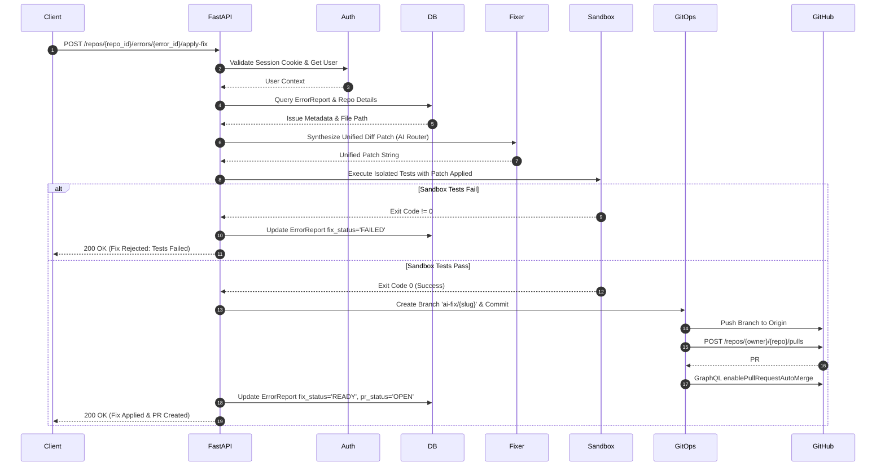

---

## 8. Database and Data Model

### 8.1 Relational Schema Specification
The relational database layer is implemented via SQLAlchemy targeting SQLite (`sqlite:///./app.db`). All entities are declared in `backend/models.py`.

#### Entity 1: `users`
Represents an authenticated user, storing GitHub OAuth profiles, encrypted personal access tokens, and encrypted multi-provider API keys.

| Field Name | Data Type | Constraints | Description |
|---|---|---|---|
| `id` | `VARCHAR(36)` | PRIMARY KEY | Unique UUID identifier for the user |
| `github_id` | `VARCHAR` | NOT NULL, UNIQUE, INDEX | Remote GitHub user identifier |
| `github_username` | `VARCHAR` | NOT NULL, INDEX | GitHub login handle |
| `github_avatar_url` | `VARCHAR` | NULLABLE | URL to GitHub user profile photo |
| `encrypted_github_token` | `TEXT` | NULLABLE | Fernet-encrypted GitHub OAuth Access Token |
| `encrypted_groq_api_key` | `TEXT` | NULLABLE | Fernet-encrypted Groq Cloud API key |
| `encrypted_nvidia_api_key` | `TEXT` | NULLABLE | Fernet-encrypted NVIDIA NIM API key |
| `encrypted_openrouter_api_key`| `TEXT` | NULLABLE | Fernet-encrypted OpenRouter API key |
| `encrypted_anthropic_api_key` | `TEXT` | NULLABLE | Fernet-encrypted Anthropic API key |
| `custom_ai_base_url` | `VARCHAR` | NULLABLE | Base URL for custom OpenAI-compatible server |
| `custom_ai_model` | `VARCHAR` | NULLABLE | Model identifier for custom OpenAI-compatible server |
| `encrypted_custom_ai_api_key` | `TEXT` | NULLABLE | Fernet-encrypted custom endpoint API key |
| `preferred_ai_provider` | `VARCHAR` | DEFAULT `'nvidia'` | Default AI provider selected by user |
| `preferred_ai_model` | `VARCHAR` | NULLABLE | Default model override selected by user |
| `created_at` | `DATETIME` | NOT NULL | UTC timestamp of record creation |

#### Entity 2: `repos`
Represents an ingested repository, tracking upload source, pipeline progress, and detected CI configurations.

| Field Name | Data Type | Constraints | Description |
|---|---|---|---|
| `id` | `VARCHAR(36)` | PRIMARY KEY | Unique UUID identifier for the repository |
| `user_id` | `VARCHAR` | NOT NULL, FOREIGN KEY (`users.id`), INDEX | Foreign key referencing owning user |
| `name` | `VARCHAR` | NOT NULL | Human-readable repository or archive name |
| `source_type` | `ENUM` | NOT NULL (`'upload'`, `'github'`) | Origin format of the codebase |
| `detected_ci` | `BOOLEAN` | NOT NULL, DEFAULT `0` | Flag indicating whether CI workflows were found |
| `detected_ci_files` | `TEXT` | NULLABLE | JSON list of detected CI workflow file paths |
| `needs_ci_setup` | `BOOLEAN` | NOT NULL, DEFAULT `0` | Flag indicating if CI setup is recommended |
| `pipeline_status` | `VARCHAR` | NOT NULL, DEFAULT `'PENDING'` | Current status: `PENDING`, `CLONING`, `PARSING`, `DONE` |
| `pipeline_error` | `TEXT` | NULLABLE | Error stack trace if pipeline failed |
| `pipeline_meta` | `TEXT` | NULLABLE | JSON blob of pipeline execution statistics |
| `created_at` | `DATETIME` | NOT NULL | UTC timestamp of ingestion |

#### Entity 3: `repo_files`
Represents an individual source code file contained within a repository.

| Field Name | Data Type | Constraints | Description |
|---|---|---|---|
| `id` | `VARCHAR(36)` | PRIMARY KEY | Unique UUID identifier for the file record |
| `repo_id` | `VARCHAR` | NOT NULL, FOREIGN KEY (`repos.id`) | Foreign key referencing parent repository |
| `path` | `VARCHAR` | NOT NULL | Relative file path within repository root |
| `language` | `VARCHAR` | NULLABLE | Detected programming language |
| `size` | `INTEGER` | NOT NULL | Size of the file in bytes |
| `content_hash` | `VARCHAR` | NOT NULL | SHA-256 hash of file content for change detection |

#### Entity 4: `symbols`
Represents a discrete syntactic code entity (function, class, method) extracted via Tree-sitter.

| Field Name | Data Type | Constraints | Description |
|---|---|---|---|
| `id` | `INTEGER` | PRIMARY KEY, AUTOINCREMENT | Unique integer identifier |
| `file_id` | `VARCHAR` | NOT NULL, FOREIGN KEY (`repo_files.id`) | Foreign key referencing parent file |
| `repo_id` | `VARCHAR` | NOT NULL, FOREIGN KEY (`repos.id`), INDEX | Foreign key referencing parent repository |
| `symbol_type` | `VARCHAR` | NOT NULL | Syntactic type: `function`, `class`, `method` |
| `name` | `VARCHAR` | NOT NULL | Identifier name of the entity |
| `source_code` | `TEXT` | NOT NULL | Complete verbatim source code snippet |
| `embedded_file_hash` | `VARCHAR` | NULLABLE | Hash of file state when embedding was computed |

#### Entity 5: `error_reports`
Represents an issue discovered by the static analysis scanner alongside its generated remediation.

| Field Name | Data Type | Constraints | Description |
|---|---|---|---|
| `id` | `VARCHAR(36)` | PRIMARY KEY | Unique UUID identifier for the error report |
| `repo_id` | `VARCHAR` | NOT NULL, FOREIGN KEY (`repos.id`), INDEX | Foreign key referencing parent repository |
| `symbol_id` | `INTEGER` | NULLABLE, FOREIGN KEY (`symbols.id`) | Associated code symbol, if localized |
| `rule_id` | `VARCHAR` | NOT NULL | Identifier of the violated rule |
| `source` | `VARCHAR` | DEFAULT `'static_analysis'` | Origin: `parser`, `static_analysis`, `build`, `test` |
| `severity` | `VARCHAR` | NOT NULL | Severity rating: `error`, `warning`, `info` |
| `message` | `TEXT` | NOT NULL | Description of the detected issue |
| `file_path` | `VARCHAR` | NOT NULL | Path of the file containing the issue |
| `line` | `INTEGER` | NULLABLE | 1-indexed line number of issue location |
| `column` | `INTEGER` | NULLABLE | Column offset of issue location |
| `explanation` | `TEXT` | NULLABLE | AI-generated root-cause explanation |
| `suggested_fix` | `TEXT` | NULLABLE | Unified diff patch string |
| `fix_status` | `VARCHAR` | NOT NULL, DEFAULT `'PENDING'` | Lifecycle: `PENDING`, `READY`, `APPLIED`, `FAILED` |
| `branch_name` | `VARCHAR` | NULLABLE | Remote Git branch name created for patch |
| `pr_url` | `VARCHAR` | NULLABLE | GitHub Pull Request web URL |
| `pr_id` | `INTEGER` | NULLABLE | GitHub Pull Request numeric number |
| `pr_status` | `VARCHAR` | NOT NULL, DEFAULT `'NONE'` | Status: `NONE`, `OPEN`, `MERGED`, `FAILED_PIPELINE` |
| `auto_fix_attempted`| `INTEGER` | NOT NULL, DEFAULT `0` | Number of automated remediation attempts |
| `created_at` | `DATETIME` | NOT NULL | UTC timestamp of issue detection |

#### Entity 6: `automation_logs`
Chronological audit trail recording every state change and action within the auto-fix and GitOps pipelines.

| Field Name | Data Type | Constraints | Description |
|---|---|---|---|
| `id` | `VARCHAR(36)` | PRIMARY KEY | Unique UUID identifier for the log entry |
| `repo_id` | `VARCHAR` | NOT NULL, FOREIGN KEY (`repos.id`), INDEX | Foreign key referencing parent repository |
| `error_id` | `VARCHAR` | NULLABLE, FOREIGN KEY (`error_reports.id`)| Associated error report being remediated |
| `stage` | `VARCHAR` | NOT NULL | Stage: `DETECTED`, `SANDBOX_PASSED`, `PR_OPENED`, etc. |
| `outcome` | `VARCHAR` | NOT NULL | Result: `SUCCESS`, `FAILED`, `INFO` |
| `message` | `TEXT` | NOT NULL | High-level summary of the event |
| `details` | `TEXT` | NULLABLE | Additional debug data, test outputs, or error traces |
| `created_at` | `DATETIME` | NOT NULL | UTC timestamp of log creation |

### 8.2 Entity-Relationship (ER) Diagram
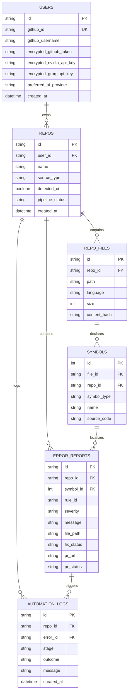

---

## 9. Database Relationships

### 9.1 Relationship Semantics and Cardinality
The database schema enforces relational integrity using foreign key constraints and declarative SQLAlchemy cascading rules.

#### Relationship 1: `User` to `Repo`
- **Cardinality:** One-to-Many (`1:N`).
- **Foreign Key:** `repos.user_id` references `users.id`.
- **Cascade Behavior:** `all, delete-orphan`.
- **Semantics:** A user can own multiple repositories. Deleting a user deletes all associated repositories, their parsed files, vector metadata, and error logs.

#### Relationship 2: `Repo` to `RepoFile`
- **Cardinality:** One-to-Many (`1:N`).
- **Foreign Key:** `repo_files.repo_id` references `repos.id`.
- **Cascade Behavior:** `all, delete-orphan`.
- **Semantics:** Deleting a repository record cascades to remove all associated file records from the database.

#### Relationship 3: `RepoFile` to `Symbol`
- **Cardinality:** One-to-Many (`1:N`).
- **Foreign Key:** `symbols.file_id` references `repo_files.id`.
- **Cascade Behavior:** `all, delete-orphan`.
- **Semantics:** A file contains multiple extracted symbols. Deleting a file purges all extracted function and class symbols.

#### Relationship 4: `Repo` to `ErrorReport`
- **Cardinality:** One-to-Many (`1:N`).
- **Foreign Key:** `error_reports.repo_id` references `repos.id`.
- **Cascade Behavior:** `all, delete-orphan`.
- **Semantics:** Discovered errors belong to a specific repository. Deleting the repository removes its historical issue tracker.

#### Relationship 5: `ErrorReport` to `AutomationLog`
- **Cardinality:** One-to-Many (`1:N`).
- **Foreign Key:** `automation_logs.error_id` references `error_reports.id`.
- **Cascade Behavior:** `all, delete-orphan`.
- **Semantics:** An automated remediation attempt against an error generates multiple sequential audit log rows (detection, sandbox result, PR creation).

### 9.2 Relationship Lifecycle Architecture
```mermaid
graph TD
    UserNode["User Entity"] -->|Creates / Deletes (Cascade)| RepoNode["Repo Entity"]
    RepoNode -->|Parses into (Cascade)| FileNode["RepoFile Entity"]
    FileNode -->|Extracts (Cascade)| SymbolNode["Symbol Entity"]
    RepoNode -->|Scans for (Cascade)| ErrorNode["ErrorReport Entity"]
    SymbolNode -.->|Optional Target| ErrorNode
    RepoNode -->|Records into (Cascade)| LogNode["AutomationLog Entity"]
    ErrorNode -->|Triggers (Cascade)| LogNode
```

---

## 10. Dependencies

### 10.1 Production Dependencies (Backend)
Derived from `backend/requirements.txt`:

| Package Name | Pinned / Detected Version | Critical Purpose in System Architecture |
|---|---|---|
| `fastapi` | `^0.115.0` | Asynchronous core REST API framework providing dependency injection and OpenAPI docs |
| `uvicorn` | `^0.30.0` | Lightning-fast ASGI production web server |
| `python-multipart`| `^0.0.9` | Streaming multi-part parser for large ZIP archive uploads |
| `gitpython` | `^3.1.43` | Native Git operations: cloning, branch creation, tree diffing, commit authoring |
| `tree-sitter` | `^0.21.3` | Incremental AST parsing library supporting concrete syntax trees |
| `tree-sitter-languages`| `^1.10.2`| Pre-compiled multilingual grammar bindings (Python, JS, TS, Java, Go, C++, Rust) |
| `faiss-cpu` | `^1.8.0` | High-efficiency similarity search and clustering for dense vector embeddings |
| `sentence-transformers`| `^3.0.1` | Local transformer model runner generating 384-dimensional dense semantic vectors |
| `groq` | `^0.9.0` | Official client library for Groq Cloud API (Llama 3 inference and Whisper STT) |
| `sqlalchemy` | `^2.0.30` | Relational database Object-Relational Mapper and SQL abstraction layer |
| `pydantic` | `^2.7.0` | Strict data validation, schema enforcement, and serialization |
| `httpx` | `^0.27.0` | Asynchronous HTTP client for communicating with NVIDIA NIM, OpenRouter, and GitHub APIs |
| `cryptography` | `^42.0.8` | Fernet symmetric authenticated cryptography for securing secrets at rest |
| `python-dotenv` | `^1.0.1` | Environment variable management and loading from `.env` files |
| `reportlab` | `^4.2.0` | Programmatic PDF generation engine for compiling formal architecture reports |

### 10.2 Frontend Dependencies
Derived from `frontend/package.json`:

| Package Name | Version | Role in Frontend Client |
|---|---|---|
| `react` / `react-dom`| `^19.2.8` | Declarative UI rendering engine with concurrent capabilities |
| `react-router-dom` | `^7.18.2` | Client-side routing across Dashboard, Docs, CI/CD, and History views |
| `@monaco-editor/react`| `^4.7.0`| VSCode-style in-browser code editor and side-by-side diff viewer |
| `mermaid` | `^11.16.1` | Real-time rendering of flowcharts, sequence diagrams, and class models |
| `lucide-react` | `^1.33.0` | Modern, clean icon library across all navigation and status bars |
| `react-markdown` | `^10.1.0` | Markdown content renderer supporting GitHub-flavored markdown extensions |
| `pdfjs-dist` | `^4.10.38` | Mozilla's standards-compliant PDF preview engine |
| `react-resizable-panels`| `^4.12.3`| Drag-to-resize split panes for multi-window developer workspaces |
| `tailwindcss` | `^4.3.3` | Modern utility-first CSS layout engine |
| `typescript` | `~6.0.2` | Static typing and compiler checks |
| `vite` | `^8.2.0` | Dev server and production bundler |

---

## 11. Configuration and Environment

### 11.1 Environment Variables Matrix
Derived from `backend/.env.example` and configuration loaders in `backend/ai/config.py` and `backend/database.py`.

| Variable Name | Required | Default Setting | Purpose & Security Classification |
|---|---|---|---|
| `NVIDIA_NIM_API_KEY` | Conditional | `<REDACTED>` | Primary LLM API authentication token. Critical secret. |
| `AI_CODE_MODEL` | No | `glm-5-3` | Model used for code generation, AST explanations, and fixes |
| `AI_CHAT_MODEL` | No | `glm-5-3` | Model used for general conversational Q&A |
| `AI_REASONING_MODEL` | No | `deepseek-v4.1-flash` | Model dispatched for complex root-cause error debugging |
| `AI_DOCUMENT_MODEL` | No | `glm-5-3` | Primary model for synthesizing 16-section technical documentation |
| `AI_LARGE_REPO_MODEL`| No | `nemotron-3-ultra-550b-a55b` | High-context model dispatched for multi-file repository analysis |
| `AI_VISION_PRIMARY_MODEL`| No | `meta/llama-3.2-11b-vision-instruct`| Multimodal image and diagram reasoning model |
| `GROQ_API_KEY` | Conditional | `<REDACTED>` | Fallback AI provider and Whisper STT token. Critical secret. |
| `AI_GROQ_CHAT_MODEL` | No | `openai/gpt-oss-120b` | Fallback chat model on Groq Cloud |
| `AI_STT_MODEL` | No | `whisper-large-v3-turbo`| Audio transcription model for speech-to-text queries |
| `OPENROUTER_API_KEY` | No | `<REDACTED>` | Tertiary fallback AI provider API token |
| `CUSTOM_AI_BASE_URL` | No | `http://localhost:11434/v1`| Endpoint for local Ollama / vLLM OpenAI-compatible server |
| `GITHUB_OAUTH_CLIENT_ID`| Yes | `<REDACTED>` | Client ID registered in GitHub Developer settings |
| `GITHUB_OAUTH_CLIENT_SECRET`| Yes | `<REDACTED>` | Client Secret registered in GitHub Developer settings |
| `GITHUB_OAUTH_REDIRECT_URI`| Yes | `http://localhost:8000/auth/github/callback`| OAuth callback URI registered with GitHub |
| `FRONTEND_URL` | Yes | `http://localhost:5173` | Target origin for OAuth browser redirects and CORS whitelist |
| `GITHUB_TOKEN` | No | `<REDACTED>` | Fallback GitHub Personal Access Token for headless CI testing |
| `ENCRYPTION_KEY` | Yes | `<REDACTED>` | 32-byte URL-safe base64 key for Fernet symmetric encryption |
| `SESSION_SECRET` | Yes | `<REDACTED>` | Cryptographic secret for signing HTTP session cookies |
| `DATABASE_URL` | No | `sqlite:///./app.db` | SQLAlchemy connection string |
| `REDIS_URL` | No | `redis://localhost:6379/0` | Cache and message broker connection string |

### 11.2 Configuration Flow Diagram
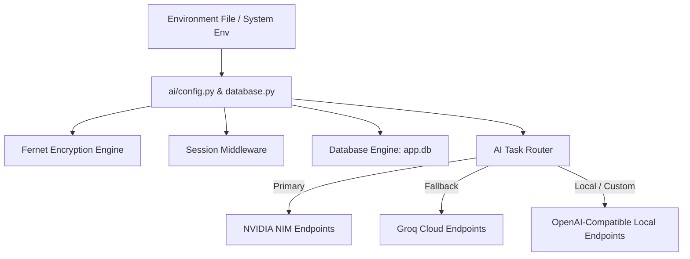

---

## 12. Testing

### 12.1 Testing Strategy & Implementation
The testing architecture spans static linting, unit testing, integration testing, isolated AST evaluation, and sandbox verification. The test suite is located in `backend/tests/` and backend root directory.

| Test File | Test Suite Focus | Validation Targets |
|---|---|---|
| `tests/test_phase1_github_auth.py` | Authentication & OAuth | GitHub login redirection, state token validation, Fernet encryption roundtrip |
| `tests/test_phase2_repo_acquisition.py` | Ingestion Subsystem | Multipart ZIP decompression, file tree extraction, path traversal sanitation |
| `tests/test_phase3_search.py` | Vector Retrieval & FAISS | Dense embedding generation, cosine similarity scoring, index persistence |
| `tests/test_phase4_error_system.py` | Static Error Detection | Scanner rule evaluation, severity tagging, error report database insertion |
| `tests/test_phase6_ai_providers.py` | AI Provider Mesh | Provider registry resolution, timeout handling, fallback failover triggers |
| `tests/test_phase7_and_8_ai_and_sandbox.py`| Closed-Loop Sandbox | Subprocess test runner detection, patch application, timeout guards (60s) |
| `tests/test_deep_fixes.py` | Patch Synthesizer | Multi-line unified diff generation, AST validity of patched code |
| `tests/test_master_ai_registry.py` | Model Registry & Limits | Context window validation, task-to-model mapping, pricing metadata |
| `test_docgen.py` | 16-Section Documentation | Master docgen execution, schema key adherence, Mermaid syntax validation |
| `test_new_scanner_eval.py` | AST Scanner Evaluation | Precision and recall benchmarks on syntax and structural flaw detection |

### 12.2 Automated Testing Pipeline
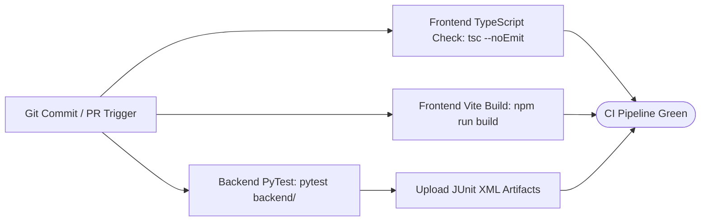

---

## 13. Security

### 13.1 Security Mechanisms and Controls
CodeBrain implements a defense-in-depth security model designed to safeguard private code repositories, user credentials, and operational infrastructure.

#### 13.1.1 Cryptographic Protection of Secrets at Rest
User-supplied GitHub Personal Access Tokens and third-party AI provider API keys are never stored as plaintext in the database. As implemented in `backend/auth.py`, CodeBrain uses the Python `cryptography` library's `Fernet` symmetric encryption implementation (AES-128-CBC with PKCS7 padding and HMAC-SHA256 authentication).
```python
def encrypt_secret(plain_text: str) -> str:
    if not plain_text:
        return ""
    f = Fernet(_get_fernet_key())
    return f.encrypt(plain_text.encode("utf-8")).decode("utf-8")
```

#### 13.1.2 OAuth Flow Security
- **Anti-CSRF State Tokens:** GitHub OAuth authentication generates a cryptographically random, timestamped `state` token verified before exchanging authorization codes for access tokens.
- **Scope Minimization:** OAuth requests are strictly constrained to `repo` and `workflow` scopes.
- **Session Authentication:** Authenticated user sessions are stored in HTTP-only, secure cookies with strict SameSite attributes, shielding tokens from client-side XSS attacks.

#### 13.1.3 Path Traversal and Ingestion Sanitation
ZIP archive uploads are verified to eliminate directory traversal vulnerabilities (Zip Slip attacks). File paths containing `..` or absolute filesystem prefixes are rejected prior to disk extraction in `backend/routers/repos.py`.

#### 13.1.4 Sandboxed Patch Execution
AI-generated patches are executed in isolated temporary scratch directories (`tempfile.mkdtemp()`) via subprocesses with non-privileged flags and strict 60-second timeouts, preventing arbitrary code execution from destabilizing the host server.

### 13.2 Security Architecture Diagram
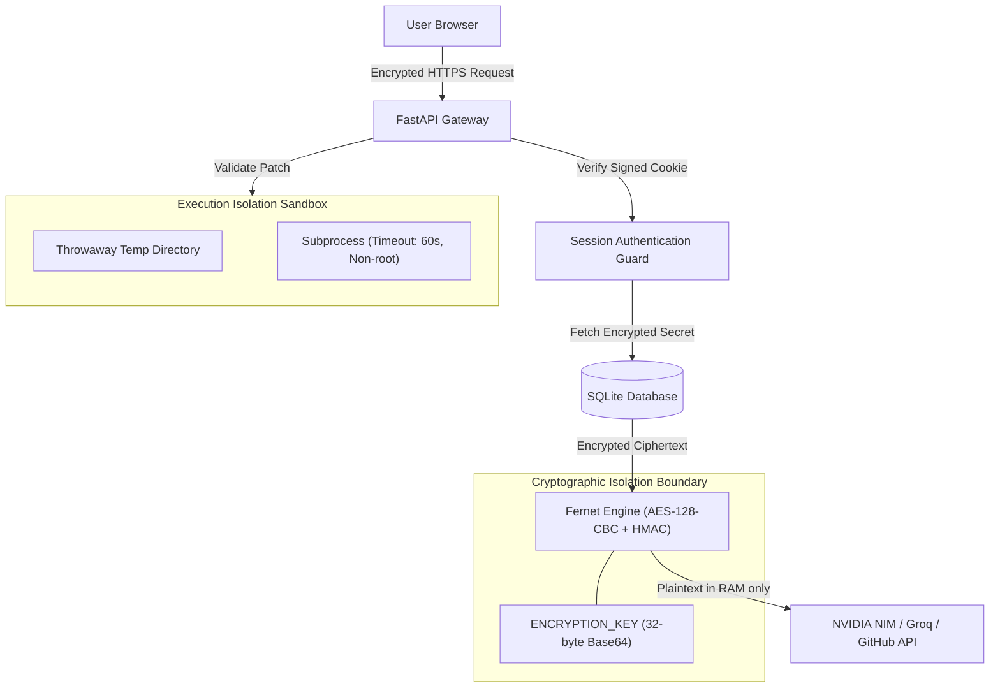

---

## 14. CI/CD Pipeline

### 14.1 Continuous Integration Workflow (`.github/workflows/ci.yml`)
The repository contains an automated GitHub Actions continuous integration pipeline verified directly in `.github/workflows/ci.yml`.

- **Trigger Conditions:** Pushes and pull requests targeted to the `main` branch.
- **Runner Environment:** `ubuntu-latest`.
- **Parallel Jobs:**
  1. `backend-tests`: Checks out code, sets up Python 3.11 with pip caching, installs `backend/requirements.txt` + `pytest pytest-asyncio`, executes the test suite, and uploads JUnit XML test results.
  2. `frontend-checks`: Checks out code, sets up Node.js 18.x with npm caching, runs `npm ci`, executes `npm run build`, and performs strict static typechecking via `npx tsc --noEmit`.

### 14.2 Autonomous CI Injection (`backend/automation/ci_setup.py`)
CodeBrain includes an autonomous CI workflow injector. When an ingested repository lacks continuous integration, CodeBrain synthesizes a repository-specific GitHub Actions configuration (`.github/workflows/ci.yml`), commits it to a new branch (`ci/setup-automated-pipeline`), and opens a pull request on behalf of the developer.

### 14.3 CI/CD Pipeline Flowchart
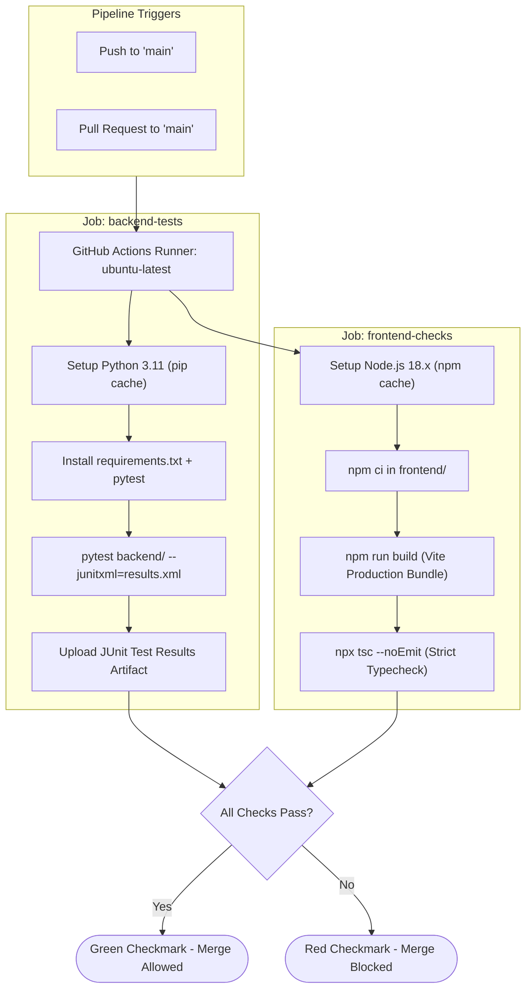

---

## 15. Deployment Architecture

### 15.1 Multi-Container Docker Topology
CodeBrain is containerized using Docker and Docker Compose (`docker-compose.yml`), separating concerns across frontend, backend, and caching layers.

| Service Name | Container Base Image | Port Mapping | Volumes / Mounts | Dependencies |
|---|---|---|---|---|
| `backend` | Python 3.11 Slim (`Dockerfile`) | `8000:8000` | `./backend/storage:/app/storage`, `./backend/app.db:/app/app.db` | `redis` |
| `frontend` | Node.js Alpine / Nginx (`Dockerfile`) | `5173:80` | None (Static build bundle served via Nginx) | `backend` |
| `redis` | `redis:7-alpine` | `6379:6379` | Ephemeral or named Redis volume | None |

### 15.2 Production Request Routing Architecture
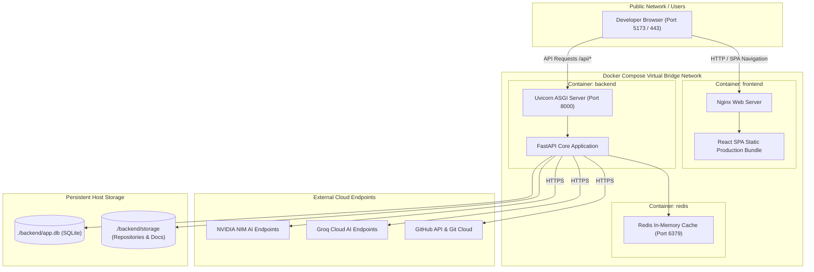

---

## 16. Setup and Developer Guide

### 16.1 System Prerequisites
- **Operating System:** Linux, macOS, or Windows 10/11 with WSL2 / PowerShell
- **Python:** Version `3.11.x`
- **Node.js:** Version `18.x` or `20.x` LTS
- **Package Managers:** `pip` (Python) and `npm` (Node)
- **Git:** Version `2.40+` installed and accessible via PATH
- **AI API Keys:** An NVIDIA NIM API key or Groq Cloud API key

### 16.2 Step-by-Step Developer Setup Guide

#### Step 1: Clone Repository
```bash
git clone https://github.com/AnniiGCP/MAJOR-PROJECT.git
cd MAJOR-PROJECT
```

#### Step 2: Configure Environment Variables
Copy the environment template and configure secrets:
```bash
cd backend
cp .env.example .env
```
Edit `.env` to configure your API keys:
```ini
NVIDIA_NIM_API_KEY=nvapi-your-key-here
GROQ_API_KEY=gsk_your-key-here
ENCRYPTION_KEY=dGhpcy1pcy1hLXNhbXBsZS1mZXJuZXQta2V5LTMyYnl0ZXM=
SESSION_SECRET=local-development-session-secret-key-2026
```

#### Step 3: Backend Virtual Environment and Dependencies
```bash
python -m venv venv
# On Windows PowerShell:
.\venv\Scripts\Activate.ps1
# On macOS / Linux:
source venv/bin/activate

pip install --upgrade pip
pip install -r requirements.txt
```

#### Step 4: Initialize Relational Database
The database initializes automatically on FastAPI startup via `init_db()`. To run standalone migrations:
```bash
python -c "import database; database.init_db()"
```

#### Step 5: Start Backend Development Server
```bash
python -m uvicorn main:app --reload --port 8000
```
*The interactive OpenAPI Swagger documentation will be available at `http://localhost:8000/docs`.*

#### Step 6: Frontend Installation and Dev Server
Open a second terminal window:
```bash
cd frontend
npm install
npm run dev
```
*The React application will be accessible at `http://localhost:5173`.*

#### Step 7: Executing Automated Tests
Run backend test suites:
```bash
pytest backend/ -v
```
Run frontend typecheck and build validation:
```bash
cd frontend
npx tsc --noEmit
npm run build
```

### 16.3 Setup Flowchart
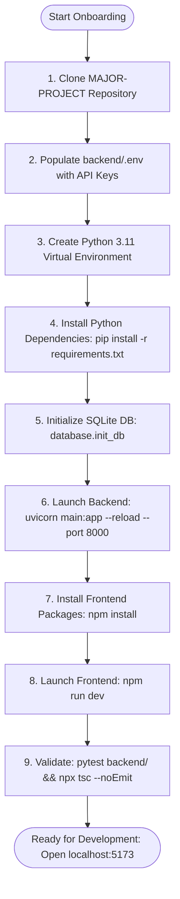

### 16.4 Common Troubleshooting Scenarios
1. **Tree-sitter Language Compilation Error on Windows:**
   - *Symptom:* `ImportError` or C++ build tool requirement when importing `tree_sitter_languages`.
   - *Remedy:* Install the pre-built wheel via `pip install tree-sitter-languages` without compiling from source, or install Microsoft C++ Build Tools.
2. **FAISS DLL Load Failure on Windows:**
   - *Symptom:* `ImportError: DLL load failed while importing _swigfaiss`.
   - *Remedy:* Ensure Visual C++ Redistributable 2015-2022 is installed on the host operating system.
3. **CORS Rejection on Custom Ports:**
   - *Symptom:* Browser blocks frontend API requests with `Cross-Origin Request Blocked`.
   - *Remedy:* Verify `backend/main.py` has `http://localhost:5173` added to `allow_origins`.
4. **Subprocess Sandbox Timeout (Error Code 124 / TimeoutExpired):**
   - *Symptom:* Automated patch validation fails with sandbox timeout error.
   - *Remedy:* Complex repositories exceeding the default 60-second test window should specify targeted sub-tests or adjust `_TIMEOUT_S` in `backend/codefix/sandbox.py`.

---
*Documentation Package generated by CodeBrain Technical Architecture Engine. Grounded strictly in repository evidence.*
